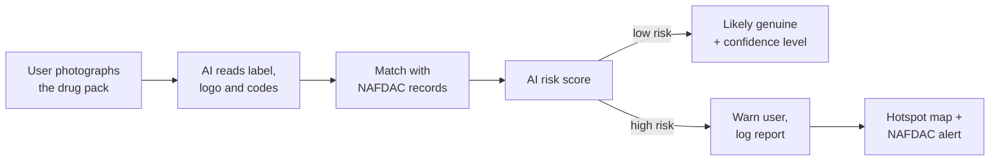
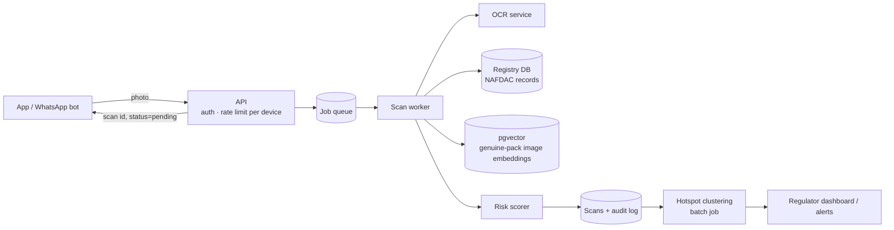

# MedVerify NG

**Verify a medicine before you take it.** MedVerify NG is a proposed AI-powered tool for spotting counterfeit and substandard drugs in Nigeria at the point of purchase.

This repository started as a **solution proposal** (Week 3 Group Assignment, AI Solution Challenge, Mastering Backend AI Engineering Bootcamp) and is now a **working MVP**, built individually as the **Final Flagship Project** by David Ohimai. The proposal is kept below from section A onward.

## The MVP today

A backend and AI service, plus a Flutter app, that **run locally** (Docker for PostgreSQL and Redis, Node for the API, a phone over USB). The project isn't deployed.

| | What works |
|---|---|
| **Scan a pack** | The live camera scanner (scan box, torch) or a gallery photo → `POST /scans` (202) → a BullMQ worker: the AI reads the label → NAFDAC register lookup → batch, expiry and recall check → the AI compares the pack with a photo of the genuine one → an explainable risk score. Progress streams live (SSE): *"watch the AI think"* |
| **Verdict** | Likely genuine / suspicious / high risk / unregistered, a 0–100 risk score, a confidence level and every reason with its weight. Shows your pack next to the genuine one. Never says "safe" |
| **Listen** | The verdict read aloud in **English, Pidgin, Hausa, Yoruba or Igbo**: translated by the light AI model (cached), spoken by the phone's own voices. If the phone has no voice for a language, the translated text is shown instead |
| **Typed-in check** | NAFDAC number (+ name, batch, expiry) against the register, with no photo and no AI |
| **Ask MedVerify** | An assistant with 8 read-only, validated tools (register, batches, your scans, nearby warnings, official guidance). It answers **only from official WHO and NAFDAC documents**, with the sources cited |
| **Hotspots** | PostGIS clustering of suspicious scans → AI-written alerts for regulators; nearby warnings for everyone |
| **Human review** | Risky or doubtful photo scans go to a pharmacist / NAFDAC review queue with deadlines (SLAs) and escalation; the reviewer's verdict reaches the user |
| **Model control plane** | Gemini, with OpenRouter as the automatic fallback; retries, circuit breaker, a daily free-quota guard, versioned prompts, and an audit row for every AI call |
| **Evaluation** | [docs/eval-results.md](docs/eval-results.md): photo pipeline 8/8 with **0 of 5 fakes passed as genuine**; retrieval hit@1 15/16; assistant 10/10 |

**Not built yet:** report-a-seller, Home insights from live data (Home shows random safety tips), auto-capture in the scanner, regulator screens in the app (the regulator features are API-only: Swagger / Postman), the "delete my data" button in the app (the endpoint exists), and real pack photos and NAFDAC registry rows (the demo uses **fictional** `X9-` packs, clearly labelled). The full list is in [mvp.md §0](mvp.md#0-mvp-status--built-vs-planned).

| Part | Stack | Guide |
|---|---|---|
| `server/` | Node 24 · TypeScript 7 · Express 5 · Prisma 7 · PostgreSQL 18 (PostGIS, pgvector) · Redis 8 · BullMQ · Gemini (OpenRouter fallback) · Swagger at `/api-docs` | [docs/server-setup.md](docs/server-setup.md) · [docs/database-setup.md](docs/database-setup.md) |
| `mobile/` | Flutter 3.47 · Riverpod 3 · go_router · Dio · camera · flutter_tts · liquid glass UI | [docs/mobile-setup.md](docs/mobile-setup.md) |

**Quick start** (full steps in the guides):

```bash
cd server && npm install && cp .env.example .env   # add JWT_ACCESS_SECRET and GEMINI_API_KEY
npm run db:up && npm run prisma:deploy && npm run seed && npm run kb:ingest && npm run simulate
npm run dev                                         # http://localhost:3000/api-docs
```

**My role:** problem research, solution design and the whole build (David Ohimai).

---

# The original proposal

## A. Problem statement

Counterfeit and substandard medicines are widespread in Nigeria's markets, patent medicine stores and some pharmacies, and buyers have no easy way to spot them at the point of purchase. Fake drugs cause treatment failure, drug resistance, deaths and financial loss. Current checks like NAFDAC's scratch codes have limited coverage and can be copied. People need a quick phone-based way to verify a drug and stop harm before it is taken.

## B. Target users

| User | Current challenge | How the problem affects them |
|---|---|---|
| Patients and caregivers | Can't spot fakes by eye; many can't read small print or English labels | Wasted money, failed treatment, health risk |
| Pharmacists and patent medicine vendors | Buy from wholesalers without a quick way to verify stock | Lost reputation, sanctions, harm to customers |
| Community health workers | Dispense drugs in rural areas far from regulators | Patients lose trust in the clinic |
| NAFDAC and state regulators | Rely on slow, manual market raids and tip-offs | Can't see in time where fakes are spreading |
| Genuine manufacturers | Brands and packaging get copied | Lost sales and damaged brand trust |

## C. Proposed AI solution

MedVerify NG is a mobile app (with a WhatsApp option) that tells a user within seconds whether a drug pack is **likely genuine, suspicious or unregistered**. The user photographs the pack. The app compares its packaging, label text, NAFDAC number and batch details with registered product records (such as NAFDAC's Greenbook) and with images of verified genuine packs.

- Verification happens **at the point of purchase**, before the drug is taken.
- No scratch code is needed, so it works on any packed product.
- Results come in English, Pidgin, Hausa, Yoruba and Igbo, including voice (in the MVP: translated text, spoken where the phone has the voice).
- Every scan feeds a **location-based hotspot map** sent to NAFDAC as an early warning.

## D. How it works



The user scans the pack. AI reads and checks it, matches it against registered records, and produces a risk score. A high score warns the user and logs the scan location, which feeds the hotspot map and alerts NAFDAC.

## E. Where AI is needed

AI is used only where fixed rules can't cope with messy real-world images and patterns. **The record lookup itself is an ordinary database search and does not need AI.**

| AI component | What it does | Why AI is necessary |
|---|---|---|
| Text recognition (OCR) | Reads the NAFDAC number, batch, expiry and names from blurry, curved or poorly lit photos | Pack photos vary too much for simple rules to read reliably |
| Image recognition | Compares logo, colours, fonts and layout with verified genuine packs | Good fakes differ in subtle visual details humans miss |
| Risk scoring | Weighs all the signals (visual match, record match, expired or duplicated batch) into one score | The signals conflict, and a trained model balances them better than yes/no rules |
| Hotspot detection | Finds clusters of suspicious scans by location and time | Spotting new patterns across thousands of scans needs pattern analysis |

## F. Expected outcome

- **Better access to information:** anyone with a phone can verify a drug in seconds, in their own language.
- **Better decisions:** patients and pharmacists reject suspicious stock before using or reselling it.
- **Faster enforcement at lower cost:** NAFDAC targets raids using live hotspot maps instead of blind inspections.
- **Better health outcomes:** fewer treatment failures, less drug resistance, and more trust in genuine brands.

## G. Risks and limitations

| Risk | Impact | Mitigation |
|---|---|---|
| Incorrect AI outputs | A fake marked "genuine" causes harm; a genuine drug marked "fake" hurts sellers | Show confidence levels, never claim "100% safe", route high-risk cases to a pharmacist or NAFDAC for review |
| Availability of data | Incomplete records and few reference images weaken accuracy | Partner with NAFDAC and manufacturers for pack images and batch data |
| User adoption and access | Low smartphone use, poor internet and low literacy in rural areas | WhatsApp and USSD options, voice results, pharmacist-assisted scanning |
| Data privacy and security | Location data could be misused; counterfeiters could probe the system | Comply with the Nigeria Data Protection Act 2023, anonymise locations, rate-limit scans |

## H. Measuring success

Success would be judged over a 12-month pilot in Lagos, Kano and Onitsha. These are **proposed targets**, to be agreed with NAFDAC.

| Indicator | How it is measured | Proposed target |
|---|---|---|
| Detection accuracy | Share of results confirmed correct by NAFDAC lab tests on sampled packs | 90% or higher |
| Response time | Time from photo upload to result shown | Under 10 seconds |
| Active users | Monthly users completing at least one scan | 100,000 by month 12 |
| Enforcement impact | Verified hotspots acted on by NAFDAC within 30 days | 50% or more |
| User satisfaction | In-app rating and short surveys | 4 out of 5 or higher |

---

## Appendix: a possible technical design

_My own sketch of how this could be built, using the patterns from the bootcamp. Not part of the original group submission._



1. **Async pipeline.** The upload returns a scan ID straight away. A queue worker runs OCR and image matching, with retries and a dead-letter queue.
2. **Exact match first.** The registration number goes through a plain indexed SQL lookup. Models are only called when that check is inconclusive.
3. **Pack similarity.** Image embeddings of verified genuine packs are stored in pgvector and compared by nearest neighbour.
4. **Explainable verdicts.** The risk score returns its contributing signals and a confidence band, never a bare yes/no.
5. **Abuse controls.** Per-device rate limits stop counterfeiters from probing the model, and every verdict is written to an audit log.

## Original submission

The original group document is in [`docs/AI_Solution_Proposal.docx`](docs/AI_Solution_Proposal.docx).
