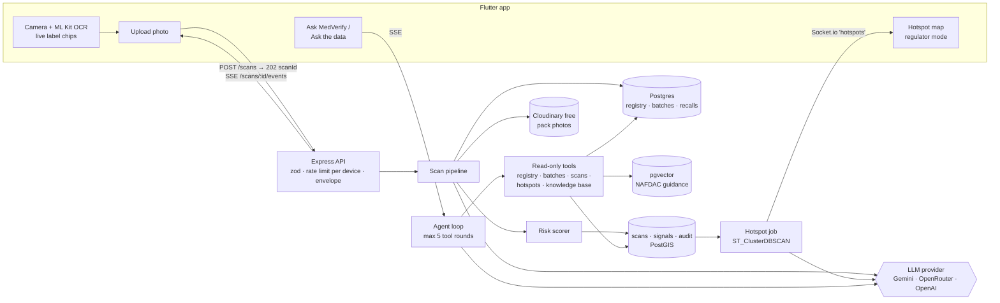

# MedVerify NG — MVP Build Plan

> Audience: me (David), building MedVerify solo for the **AI Engineering Bootcamp Final Flagship Project** (Cohort 2).
> Goal: a working backend + AI solution to the group PRD's problem that I can explain and defend on Demo Day. Every feature here either **proves the engineering is real** or **makes the demo land**. Anything else waits.
> Hard constraint: **nothing that needs payment, a card on file or a subscription.** Every service below has a free tier that works without one (§11).

## Scope — from the official Flagship Project brief (governs everything below)

| The brief says | What it means for MedVerify |
|---|---|
| **Deadline: Thursday 5 November 2026** | Everything submitted by then. Plan in §7. |
| Build a **functional backend and AI-powered solution** for the group PRD's problem; **no frontend or UI required** | The marks are for `server/`: APIs, data handling, business logic, the AI. The Flutter app is a **bonus** — it already looks great; extend it only when the backend for that feature is done and tested. |
| Not production-ready — a **solid, working core** you can explain and defend | Depth over breadth. Every feature must be something I can whiteboard. |
| **Individual** implementation of the group problem | My own code, decisions and docs. |
| Deliverable 1: **GitHub repo** — complete code, clear README, setup/installation, dependencies, docs, **no exposed secrets** | Repo access for the tutor (it's private — add them as a collaborator). `.env` stays git-ignored; CI proves it builds. |
| Deliverable 2: **Functions Overview Document** — problem, solution, features, how the backend works, how AI is used, tech, key decisions, challenges, future work, repo link | Written on 4 Nov from these docs. |
| Deliverable 3: **Slide deck** based on that document — problem, solution, what I built, features, technical approach, AI, tech, challenges & lessons, future work, repo | Supports the talk; doesn't repeat the document. |
| Postman demo is **optional** (can come after Demo Day) | Swagger at `/api-docs` covers API exploration; a Postman collection only if time allows. |
| Demo Day judges **understanding and communication**, not just whether it works | The defense questions in [docs/server-setup.md](docs/server-setup.md) Part C, and a rehearsal on 4 Nov. |

### Submission checklist (5 Nov)

- [ ] Repo: README with problem, solution, architecture, setup — all commands work from a fresh clone
- [ ] Repo: no secrets (`git grep` for keys before submitting), tutor has access
- [ ] Repo: CI green on `main`
- [ ] Functions Overview Document — every section from the brief, with the repo link
- [ ] Slide deck — every topic from the brief, with the repo link
- [ ] Every link opened from a logged-out browser / the tutor's view

---

## 0. TL;DR checklist

- [ ] **No sign-up / sign-in.** The app registers the device silently and gets a token (§2). Regulator mode is unlocked with a demo PIN.
- [ ] Monorepo: `mobile/` (Flutter 3.47 + Riverpod 3), `server/` (Express 5 + TypeScript 7 + Prisma 7 + PostgreSQL 18 + Redis 8), `docs/`.
- [ ] Server follows the **bootcamp's DocuChat architecture** (layered routes → controllers → services → repositories, Zod, events, BullMQ, Redis rate limits, Pino, Prometheus, Swagger) — see §12 for lesson-by-lesson coverage. Build guides: [docs/server-setup.md](docs/server-setup.md), [docs/database-setup.md](docs/database-setup.md).
- [ ] Flutter core extracted from **Laba** (network, failures, storage, theme, router), restyled with an **Idey × Laba × Ridify** palette, the **Satoshi** font and the screenshot layout language (soft cards, pill tabs, orange FAB).
- [ ] **Every loading state is a shimmer skeleton** shaped like the content it replaces. No bare spinners.
- [ ] Scan flow: **live camera OCR → upload → streamed AI steps → animated verdict with reasons → listen → report.**
- [ ] AI: **Gemini (free tier)** by default behind a provider interface; **OpenRouter free models** as fallback; OpenAI pluggable later. Vision for label reading + pack comparison (structured JSON), a transparent risk scorer, PostGIS hotspot clustering, AI-written regulator alerts.
- [ ] **Agent with data-search tools:** "Ask MedVerify" (public) and "Ask the data" (regulator) call read-only tools that search the registry, batches, recalls, scans, hotspots and the knowledge base. Tool calls show live in the UI.
- [ ] **Local Postgres in Docker** (PostGIS + pgvector + pgAdmin) — follow [docs/database-setup.md](docs/database-setup.md) to start it, run the server, run tests and see the data.
- [ ] **Live hotspot map** on the projector: a fake pack scanned on stage drops a red pulse on the map within seconds.
- [ ] A small **labelled eval set** (≈40 photos) so I can say on stage how accurate it is, and mean it.

---

## 1. What makes the audience go "wow"

The demo is 5 minutes. These are the moments, in order. Build these first; everything else is support.

| # | Moment | What the audience sees | What makes it real |
|---|---|---|---|
| 1 | **The camera reads the pack live** | Point the phone at a pack: chips pop up on screen — `NAFDAC A4-1234 ✓`, `EXP 08/2027`, `BATCH LT2391` — and it auto-captures | On-device ML Kit OCR + regex, free and offline |
| 2 | **You watch the AI think** | A step timeline ticks through: *Reading label → Checking NAFDAC registry → Comparing with genuine packs → Checking batch history → Scoring risk*; the active step shimmers | Server streams each pipeline step over SSE as it really finishes |
| 3 | **The verdict reveal** | A ring animates to **82 / High risk**, the screen turns red, the phone vibrates. Below: *"Why we think so"* with each signal and its weight | Explainable score (§6.4), never a bare yes/no |
| 4 | **Side-by-side with the genuine pack** | Your photo next to the verified reference, with the differences listed: *"Logo green is darker", "'Artemether' misspelt 'Artemeter'"* | Gemini vision comparison with a JSON schema |
| 5 | **It speaks Pidgin** (and shows Hausa / Yoruba / Igbo) | Tap 🔊 → *"Abeg no use this drug. E fit be fake."* | LLM translation + on-device TTS |
| 6 | **The map lights up** | On the projector (regulator mode), a red pulse lands on the Lagos map the moment the fake is scanned; an **AI Alert** card appears: *"3 suspicious Amatem packs from batch LT2391 around Idumota in 2 hours — likely cloned batch"* | Socket.io push + PostGIS `ST_ClusterDBSCAN` + LLM summary |
| 7 | **Ask the data** | Regulator types *"Which batches are spreading fastest this week?"* → chips appear as the agent works: `🔎 query_scans(group_by: batch, window: 7d)` → `📍 get_hotspots(7d)` → answer with a mini table | Agent with read-only, validated tools over Postgres (§6.8) |
| 8 | **Ask MedVerify** | Orange ✨ FAB → *"Is Amatem batch LT2391 safe?"* → `🔎 check_batch` → `📚 search_knowledge` → grounded answer with citations | Same agent, public tool set + RAG |
| 9 | **"How accurate is it?"** | One slide: *tested on 40 labelled packs — X% correct, 0 fakes called genuine, median 6 s, ₦0 per scan* | Eval script (§6.7). Honest numbers beat big claims |

---

## 2. Do we need sign-up / sign-in? **No.**

You're right not to want it. The proposal names **user adoption** as a top risk — every form between "open app" and "scan" loses people, and the demo loses 30 seconds on a login screen.

But we still need an identity, because the README promises **per-device rate limits** (to stop counterfeiters probing the model), a **scan history**, and an **audit log**. So:

| Need | MVP solution |
|---|---|
| Who is scanning (rate limit, history, audit) | **Silent device registration.** First launch: `POST /devices/register { installId, platform, appVersion, language }` → 15-minute access token (`role: "public"`) + 30-day refresh token. The install id is a random UUID kept in secure storage; the server stores only its SHA-256 hash. No screens. |
| Regulator / pharmacist view | **Regulator mode** in Settings. Enter a PIN (`REGULATOR_DEMO_PIN` env) → `POST /devices/me/elevate` → new token pair with `role: "regulator"`. 5 attempts per 15 min, constant-time compare. Unlocks the Hotspot Map tab, alert feed and "Ask the data". |
| Token expiry | The app refreshes silently on `TOKEN_EXPIRED` (`POST /devices/refresh`, rotating, single in-flight). Re-using an old refresh token revokes its whole chain. If refresh fails, the app re-registers with the same install id (role resets to public). |
| Losing the phone | Nothing personal is stored. Scan history is tied to the device, and "Delete my data" wipes it (NDPA 2023). |

Say this on stage — it's a design decision, not a shortcut: *"No account needed. That's deliberate: a mother at a patent medicine store won't fill a sign-up form."*

Real accounts (pharmacist verification, NAFDAC officer SSO) are **post-MVP**.

---

## 3. Architecture



Three decisions that keep this buildable in 2 weeks:

1. **Async contract, queued execution.** `POST /scans` returns `202 { scanId }` like the README appendix says. The scan goes on a **BullMQ** queue in Redis (retries with exponential backoff, dead-letter queue, Bull Board), and the worker publishes each step to Redis pub/sub, which the API streams to the app over SSE. In development the worker runs in the same process; in production it can run separately. Same pattern as DocuChat's ingestion worker.
2. **Exact match before any model.** NAFDAC number → indexed SQL lookup first. The LLM is only called for what rules can't do (reading messy photos, comparing packs, writing summaries, choosing which tools to call). This is the README's own principle; say it out loud.
3. **One LLM interface, several providers.** Free tiers have rate limits; a provider switch is an env var, and the server falls back automatically (§6.1).

### Repo layout

```
medverify-ng/
├── README.md            # the proposal (unchanged)
├── mvp.md               # this file
├── docs/
│   └── database-setup.md
├── mobile/              # Flutter app
└── server/              # Express + TypeScript API
    ├── docker-compose.yml
    ├── docker/postgres/
    └── seed/            # registry CSV, reference images, simulated scans, RAG docs
```

---

## 4. Flutter app (`mobile/`)

### 4.1 Stack

All packages are free and open source.

| Concern | Choice | Source |
|---|---|---|
| State | `flutter_riverpod` + `riverpod_annotation` / `riverpod_generator` | Laba |
| DI | **Riverpod providers only** (drop `get_it` — one DI system is less code to explain) | change from Laba |
| Routing | `go_router` with a `StatefulShellRoute` for bottom tabs | Laba |
| Network | `dio` + interceptors (logging, device-auth, retry) | Laba `core/network` |
| Errors | `dartz` `Either<Failure, T>`, `Failure` hierarchy | Laba `core/errors` |
| Storage | `flutter_secure_storage` (token), `shared_preferences` (theme, language, onboarding), `hive_flutter` (scan history cache, offline) | Laba `core/storage` |
| Loading | **`shimmer`** — skeletons for every loading state (§4.3) | new |
| Liquid glass | **`liquid_glass_widgets`** — shader-based glass on Android + iOS: `GlassTabBar.bottom` (floating tab bar with sliding glass pill), `GlassAppBar`, `GlassSheet`, `GlassButton`, `GlassBadge`. Glass only on floating chrome; list cards stay solid (performance) | new |
| Camera + OCR | `camera`, `google_mlkit_text_recognition` (on-device, free) | new |
| Streaming | SSE over Dio `ResponseType.stream` (small parser, no extra package) | new |
| Realtime | `socket_io_client` | Laba |
| Map | `flutter_map` + `latlong2` with **CARTO Positron (light) / Dark Matter (dark)** tiles, switched with the app theme: muted modern basemaps so the hotspot circles stand out (free, no key; show attribution). Upgrade option: **MapTiler** free plan (no card, API key) for its Streets/Dataviz styles | Laba history |
| Voice | `flutter_tts` (device voices, free) | Laba |
| Location | `geolocator` (coarse, rounded server-side) | Laba |
| Animation | `lottie`, `flutter_animate` (verdict ring, chip pop-ins) | Laba + new |
| Share | `share_plus` (share warning card as image) | Laba |
| Icons | `iconsax` | Laba |
| Lints/tests | `flutter_lints`, `mocktail` | Laba |

### 4.2 Template to extract from Laba

Copy these from `C:\Users\David\laba\labafood-mobile\lib\core\` into `mobile/lib/core/`, then trim:

| Laba file | Keep | Change |
|---|---|---|
| `errors/failures.dart`, `exceptions.dart` | `Failure`, `ServerFailure`, `NetworkFailure`, `CacheFailure`, `ValidationFailure`, `NotFoundFailure`, `UnexpectedFailure`, `PermissionFailure` | Drop the `AUTH_00x` failures. Add `RateLimitedFailure` (429, carries `retryAfter`) and `ScanFailedFailure` (pipeline error, carries `scanId`). |
| `network/api_client.dart`, `api_interceptors.dart` | `ApiClient`, `LoggingInterceptor`, `RetryInterceptor`, envelope parsing | Replace `AuthInterceptor` + `TokenRefreshInterceptor` with one `DeviceAuthInterceptor` (adds the token; on 401, re-registers once and replays). Drop Crashlytics. Add `stream()` for SSE and `upload()` for multipart. |
| `network/network_info.dart`, `paginated_response.dart` | as is | — |
| `storage/*` | as is | Keys: `deviceToken`, `installId`, `themeMode`, `language`, `onboardingDone`, `regulatorMode`. |
| `theme/app_theme.dart`, `theme_provider.dart`, `app_typography.dart` | structure, light/dark `ThemeData`, persisted `ThemeMode` | New colors (§4.3), Satoshi font. Remove `poppins_scope.dart`, `accent_theme.dart`. |
| `constants/*` | `api_constants`, `app_constants`, `env_variables` (`--dart-define-from-file`), `storage_keys` | MedVerify values. `API_URL`, `SOCKET_URL`. |
| `extensions/context_extensions.dart` | as is (theme, size, breakpoints, snackbars) | Add `context.verdictColors`. |
| `utils/validators.dart`, `formatters.dart`, `logger.dart` | as is | Add NAFDAC number validator/formatter. |

**Responsiveness:** keep Laba's approach (breakpoints in `context_extensions`, `LayoutBuilder`, max content width 560 on tablets). Every screen must work at 360 dp wide and in dark mode — check both before marking a screen done.

### 4.3 Design system

**Font: Satoshi** — the font from the screenshots. Free under the Fontshare licence (download the OTFs from fontshare.com into `mobile/assets/fonts/`):

```yaml
flutter:
  fonts:
    - family: Satoshi
      fonts:
        - asset: assets/fonts/Satoshi-Light.otf
          weight: 300
        - asset: assets/fonts/Satoshi-Regular.otf
          weight: 400
        - asset: assets/fonts/Satoshi-Medium.otf
          weight: 500
        - asset: assets/fonts/Satoshi-Bold.otf
          weight: 700
        - asset: assets/fonts/Satoshi-Black.otf
          weight: 900
```

Type scale in `app_typography.dart` (there's no 600 weight, so headings use 700):

| Style | Weight | Size | Used for |
|---|---|---|---|
| `display` | Black 900 | 40 | Risk score in the ring |
| `headlineLarge` | Bold 700 | 32 | Page titles ("Overview", "Scans") |
| `headlineMedium` | Bold 700 | 28 | Greeting, StatCard numbers |
| `titleLarge` | Bold 700 | 20 | Section headers ("Needs Your Attention") |
| `titleMedium` | Medium 500 | 17 | Card titles |
| `bodyLarge` / `bodyMedium` | Regular 400 | 16 / 14 | Body, field values |
| `labelLarge` | Medium 500 | 15 | Buttons, chips, tabs |
| `bodySmall` | Light 300 | 13 | Hints ("Must be at least 8 characters"), meta lines |

**Palette** — Idey's trust navy + orange CTA, Laba's green, Ridify's sky blue, and the screenshots' purple→blue AI gradient. Orange is the **action** colour, never a verdict colour, so it can't be confused with "suspicious".

| Token | Light | Dark | From | Used for |
|---|---|---|---|---|
| `primary` | `#023047` navy | `#8ECAE6` | Idey splash / accent | App bar titles, primary text accents, selected tab |
| `primaryContainer` | `#E3F1F8` | `#0B3A52` | — | Selected chips, soft panels |
| `action` | `#FF8C00` orange | `#FFA53D` | Idey CTA / screenshots | Scan button, ✨ FAB, "See all", primary buttons |
| `actionContainer` | `#FFF1E0` | `#4A2A05` | — | Icon tiles, outlined-pill selected state |
| `info` | `#38B6FF` sky | `#7CCFFF` | Ridify | Links, info chips |
| `aiGradient` | `#6155F5 → #38B6FF` | same | Idey purple + Ridify | "AI Insight" pill, AI step timeline, tool chips, chat bubbles |
| `genuine` | `#1E8A4A` | `#5CB87E` | Laba primary | Likely-genuine verdict |
| `suspicious` | `#D97706` amber | `#FBBF24` | Laba tertiary | Suspicious verdict |
| `danger` | `#E74C3C` | `#FF8A80` | Idey error | High-risk / unregistered / recalled, overdue text |
| `background` | `#F7F8FA` | `#0F172A` | Laba | Page |
| `surface` | `#FFFFFF` | `#1E293B` | Laba | Cards |
| `outline` | `#D5DAE2` | `#374151` | Laba | Inputs, outlined pills |
| `shimmerBase` / `shimmerHighlight` | `#ECEEF2` / `#F7F8FA` | `#28344A` / `#334155` | Laba surface ramp | Shimmer skeletons |
| `textPrimary` / `textSecondary` | `#1F2937` / `#6B7280` | `#F9FAFB` / `#94A3B8` | Laba | Text |

Each verdict colour also gets a `…Container` tint (10–12% alpha) for card backgrounds, like the "Pending" chips in the screenshots.

**Liquid glass.** Floating chrome is liquid glass (`liquid_glass_widgets`): the bottom tab bar floats above content with a sliding glass pill under the selected tab (badge for alerts), plus the app bar, ✨ FAB, bottom sheets, verdict overlay and the AI Insight card. Every screen sits on a soft mesh gradient (navy / orange / AI purple tints at low opacity) so the glass has colour to refract. Scrolling list cards stay solid white/slate — glass inside scrolling lists is the expensive case. Quality `standard` by default; `minimal` fallback if a low-end demo phone drops frames. Glass follows the app's theme via `brightnessResolver: Theme.maybeBrightnessOf`.

**Loading = shimmer.** One rule: whatever is loading is drawn as a shimmer skeleton with the same shape as the loaded content, so the layout never jumps.

- `AppShimmer` wraps `Shimmer.fromColors` with the theme's `shimmerBase` / `shimmerHighlight` (so it works in dark mode) and a 1.2 s period.
- `ShimmerBox` / `ShimmerLine` / `ShimmerCircle` primitives (rounded like the real widgets).
- One skeleton per real card: `StatCardSkeleton`, `AttentionCardSkeleton`, `ScanListCardSkeleton`, `AiInsightCardSkeleton`, `VerdictSkeleton`, `MapStatsSkeleton`, `ChatAnswerSkeleton`.
- List screens show 3–4 skeleton cards; paginated lists show one skeleton card at the bottom while the next page loads.
- The **active step** in the AI timeline and the **pending tool chip** in chat use a shimmering label instead of a spinner.
- The only spinner left is inside a pressed button (small, white, replaces the label).

**Components to build once** (in `lib/shared/widgets/`), modelled on the screenshots:

| Widget | Looks like | Used in |
|---|---|---|
| `AppScaffold` | Title left of a menu icon, search + bell (with red count badge) right | every tab |
| `GreetingHeader` | "Good morning 👋" + subtitle | Home |
| `AiInsightCard` | Lavender→sky tinted card, gradient "✨ AI Insight" pill, icon + coloured line items | Home, Map, Verdict |
| `StatCard` | Big number, label, trend line ("↗ +7 this week"), tinted icon tile top-right | Home, Map |
| `AttentionCard` | Icon tile, title, subtitle, red "Oldest: …" line, big coloured count, chevron | Home ("Needs your attention") |
| `QuickActionTile` | Pastel square tile, centred icon + label, horizontal scroll | Home |
| `ScanListCard` | Title + status chips, meta lines, coloured type label bottom-left, grey pill bottom-right, ⋮ menu | History, Home "Recent scans" |
| `StatusChip` | Pill with tinted background (`Genuine`, `Suspicious`, `High risk`, `Unregistered`, `Reported`) | everywhere |
| `PillTabs` | Outlined pill tabs, selected = orange outline + orange text | Settings, Map filters, Verdict (Details / Compare) |
| `AppTextField`, `AppDropdown`, `AppDateField` | 12 px radius, outlined, label above field, grey placeholder | Manual check, Report |
| `PrimaryButton` / `OutlineButton` | Full-width pill; disabled = 40% orange (like "Next") | forms |
| `StepProgress` | "0 of 2 steps completed" + segmented bar | Report form |
| `SparkleFab` | Rounded-square orange FAB with ✨ | all main tabs → Ask MedVerify |
| `DangerZoneCard` | Red outlined card, type-to-confirm input, red pill button | Settings |
| `VerdictRing` | Animated circular score, colour by band | Verdict |
| `AiStepTimeline` | Vertical steps: done = check, active = shimmering label, gradient line | Analysing |
| `ToolCallChip` | Small gradient-outlined chip: icon + tool name + short args; shimmers while running, ticks when done, tap to expand the result summary | Chat, Ask the data |
| `AppShimmer` + skeletons | see "Loading = shimmer" above | every async screen |
| `EmptyState`, `ErrorView` (retry) | — | all lists |

### 4.4 Screens

Bottom tabs: **Home · History · Scan (centre, orange) · Map\* · Settings**. (\*Map tab shows only in regulator mode; public users get an "Alerts near you" list instead.)

| # | Screen | Contents | Priority |
|---|---|---|---|
| 1 | **Splash + onboarding** (3 slides) | What it does · pick language (en / pcm / ha / yo / ig) · location rationale + "never 100% safe" disclaimer. Silent device registration happens here. | P0 |
| 2 | **Home** | Greeting · AI Insight card (*"2 fake Postinor batches reported in Lagos this week"*, *"Your last scan: Amatem — high risk"*) · 4 StatCards (My scans, Genuine, Suspicious, Alerts near me) · **Needs your attention** (recalls near you, scans not yet reported) · Quick actions (Scan pack, Enter NAFDAC no., Ask MedVerify, Report a seller) · Recent scans. Shimmer skeleton for each block while loading. | P0 |
| 3 | **Scanner** | Full-screen camera, pack-shaped frame overlay, live OCR chips, torch toggle, auto-capture when NAFDAC no. + expiry found, manual shutter fallback, "Add back of pack" optional second shot | P0 |
| 4 | **Analysing** | Captured photo thumbnail + `AiStepTimeline` fed by SSE; graceful fallback to polling if the stream drops | P0 |
| 5 | **Verdict** | `VerdictRing` + verdict chip + one-line advice · 🔊 Listen + language chips · **Why we think so** (signals with +/– weights) · PillTabs: *Details* (name, NAFDAC no., batch, expiry, manufacturer — each with a ✓/✗ against the registry) / *Compare* (your photo vs genuine reference + differences list) · Actions: **Report to NAFDAC**, **Share warning**, **Ask about this drug** | P0 |
| 6 | **History** | Search, filter (verdict), sort; `ScanListCard`s; tap → Verdict; works offline from Hive | P1 |
| 7 | **Manual check** | Form: NAFDAC number (formatted), product name (dropdown search), batch, expiry date → registry-only verdict (no photo) | P1 |
| 8 | **Report** (2 steps) | Step 1: seller/pharmacy name, area (dropdown), date bought, price · Step 2: photos (pre-filled from scan), notes, consent → confirmation with reference number | P1 |
| 9 | **Hotspot Map** (regulator) | Map with cluster circles sized by count, coloured by severity, live pulses · PillTabs: 24 h / 7 d / 30 d · AI Alert cards (bottom sheet) · StatCards: scans today, suspicious %, active hotspots, drugs affected · **"Ask the data"** input at the top of the alerts sheet | P0 (it's the finale) |
| 10 | **Ask MedVerify / Ask the data** | Chat with streamed answer, `ToolCallChip`s above each answer, citation chips, suggested questions, scan context passed in when opened from a verdict. Same screen; the tool set depends on role. | P0 |
| 11 | **Settings** | PillTabs *Preferences* / *About*: language, theme (System / Light / Dark), notifications, **Regulator mode** (PIN) · Data: export my scans (CSV) · Danger zone: **Delete my data** (type "DELETE") | P1 |

### 4.5 Folder structure

Laba's clean architecture, one folder per feature:

```
lib/
├── main.dart · app.dart · bootstrap.dart
├── core/          # constants, errors, network, storage, theme, router, extensions, utils
├── shared/widgets/   # incl. shimmer/ (AppShimmer, primitives, per-card skeletons)
└── features/
    ├── onboarding/      # + device registration
    ├── home/
    ├── scan/            # scanner, analysing, verdict  (data / domain / presentation)
    ├── history/
    ├── manual_check/
    ├── report/
    ├── hotspots/        # map, alerts, socket
    ├── assistant/       # chat + tool-call chips (public and regulator)
    └── settings/
```

Each feature: `data/` (datasource, models with `fromJson`), `domain/` (entities, repository interface, use cases), `presentation/` (providers, screens, widgets). Providers return `AsyncValue`; repositories return `Either<Failure, T>`. Screens map `AsyncValue` with one helper: `loading → skeleton`, `error → ErrorView(retry)`, `data → content`.

### 4.6 Key flows in code terms

**Live OCR chips (scanner):** stream camera frames to ML Kit every ~400 ms (throttled), run regexes over the recognised text, show a chip when a field is found twice in a row (debounce flicker). Starting patterns — tune against real packs:

```dart
final nafdac = RegExp(r'\b(?:NAFDAC\s*(?:REG\.?\s*)?(?:NO\.?)?\s*[:.]?\s*)?([A-Z]?\d{1,2}[A-Z]?-\d{4,6}[A-Z]?)\b', caseSensitive: false);
final expiry = RegExp(r'\b(?:EXP|EXPIRY|EXP\.?\s*DATE)\s*[:.]?\s*(\d{2}[/\-.]\d{2,4}|[A-Z]{3}\s?\d{2,4})', caseSensitive: false);
final batch  = RegExp(r'\b(?:BATCH|LOT|B\.?\s*NO)\s*[:.]?\s*([A-Z0-9\-]{3,12})', caseSensitive: false);
```

The on-device text is sent as a **hint** with the upload; the server still reads the photo itself (the device OCR is fast but not trusted).

**Scan (verdict) flow:**
1. `POST /scans` (multipart: `front`, optional `back`, `ocrHint`, `lat`, `lng`) → `202 { scanId }`.
2. Open `GET /scans/:id/events` (SSE). Each `step` event updates the timeline; `verdict` event navigates to Verdict; `error` shows retry.
3. If SSE fails, poll `GET /scans/:id` every 1.5 s until `status` is `done`/`failed`.
4. Cache the result in Hive for History.

**Chat flow:** `POST /assistant/messages` streams SSE events `tool_start { name, args }` → `tool_end { name, summary }` → `token { text }` → `citations [...]` → `done`. Each `tool_start` adds a shimmering `ToolCallChip`; `tool_end` ticks it.

---

## 5. Backend (`server/`)

### 5.1 Stack

Built on the **bootcamp's DocuChat architecture** — the layered structure, Zod validation, event bus, BullMQ queues, Redis-backed rate limits, observability and AI plumbing (chunking, retrieval, prompt-injection check, circuit breaker + retries) — with the tool-calling pattern from **Tools-for-LLM** / **agentic-ai** and Socket.io/Cloudinary from **LabaFood**. Step-by-step: [docs/server-setup.md](docs/server-setup.md).

| Concern | Choice (all free, latest stable as of Oct 2026) |
|---|---|
| Runtime | Node 24, TypeScript 7 (ESM), Express 5, `tsx` in development |
| DB (local) | **PostgreSQL 18 + PostGIS 3.6 + pgvector + pg_trgm in Docker** (port 5433), browsed with Prisma Studio — [docs/database-setup.md](docs/database-setup.md) |
| ORM | **Prisma 7.10** (driver adapter `@prisma/adapter-pg`); `Unsupported("vector")` / `geography` columns via `$queryRaw` |
| Redis | Redis 8 in Docker (ioredis 6): rate limits, cache, BullMQ queues, scan-progress pub/sub |
| Queue | BullMQ 6: scan pipeline worker, hotspot job, dead-letter queue, Bull Board |
| DB / Redis (deployed) | Neon free plan (PostGIS + pgvector) · Render Key Value free (Redis-compatible) |
| Files | Cloudinary free plan (no card) |
| Realtime | Socket.io room `hotspots` (regulator role only) |
| Streaming | SSE for scan progress and chat |
| AI | `@google/genai` (Gemini), `openai` npm SDK pointed at OpenRouter (and OpenAI later) — behind one `LlmProvider` interface (the bootcamp's "model control plane") |
| Embeddings | Gemini embeddings (free tier); fallback: local `@huggingface/transformers` (runs on CPU, no API at all) |
| Validation / security | Zod 4 on every input and tool argument · `xss` sanitising · Helmet CSP · CORS allowlist · rotating refresh tokens |
| Observability | Pino (redacted, correlation ids) · prom-client `/metrics` · `/health/live` + `/health/ready` · Swagger at `/api-docs` |
| Tests | Vitest 5 + Supertest (unit + HTTP, no DB); integration tests against `medverify_test` |
| Deploy | Render free web service (no card) — sleeps when idle, so wake it 2 min before the demo; backup: run locally + Cloudflare quick tunnel (`cloudflared tunnel --url`, free, no account) |

### 5.2 Response envelope

Same as Laba, so the Flutter `ApiClient` works unchanged:

```json
{ "success": true, "message": "Scan complete", "statusCode": 200, "data": { }, "errors": [], "meta": null }
```

### 5.3 Endpoints

All under `/api/v1`. `D` = device token (any role), `R` = regulator role.

| Method | Route | Auth | Purpose |
|---|---|---|---|
| POST | `/devices/register` | — | `{ installId, platform, appVersion, language }` → `{ device, tokens }` ✅ built |
| POST | `/devices/refresh` | — | `{ refreshToken }` → rotated `{ tokens }` ✅ built |
| GET / PATCH | `/devices/me` | D | profile / language ✅ built |
| POST | `/devices/me/elevate` · `/devices/me/demote` | D | `{ pin }` → regulator tokens / back to public ✅ built |
| DELETE | `/devices/me` | D | Delete my data (scans anonymised, photos removed) ✅ built |
| POST | `/scans` | D | multipart `front`, `back?`, `ocrHint?`, `lat?`, `lng?` → `202 { scanId }`. **Rate limit: 10/min, 60/day per device** (also protects the free LLM quota). |
| GET | `/scans/:id/events` | D | SSE: `step`, `verdict`, `error` |
| GET | `/scans/:id` | D | Full scan: verdict, score, confidence, signals, extracted fields, reference image, differences |
| GET | `/scans` | D | My history, paginated |
| GET | `/scans/:id/speech?lang=yo` | D | Verdict text in that language (cached) |
| POST | `/verify/manual` | D | `{ nafdacNo, productName?, batchNo?, expiry? }` → registry-only verdict ✅ built |
| GET | `/products/search?q=` | D | Registry search for the manual-check dropdown ✅ built |
| POST | `/reports` | D | `{ scanId?, sellerName, area, price?, notes, photos[] }` → `{ reference }` |
| GET | `/insights/home` | D | AI Insight lines + stat cards + attention items for Home |
| GET | `/alerts/nearby?lat&lng` | D | Recalls and hotspots near the user (public view) |
| GET | `/hotspots?window=24h\|7d\|30d` | R | Clusters (centroid, radius, count, severity, top drug/batch) |
| GET | `/hotspots/alerts` | R | AI-written alerts, newest first |
| GET | `/hotspots/stats` | R | Map StatCards |
| POST | `/assistant/messages` | D | `{ message, conversationId?, scanId? }` → SSE stream (`tool_start`, `tool_end`, `token`, `citations`, `done`). Tool set chosen by role. |
| GET | `/assistant/tools` | D | Tools available to this role (for the "what can I ask?" sheet) |
| GET | `/health/ready` | — | readiness (DB + LLM provider reachable) |

Socket.io (regulator): `scan:flagged { lat, lng, severity, product }` on every suspicious/high-risk scan; `hotspot:updated { cluster }`; `alert:new { alert }`.

### 5.4 Data model

```
devices          id, install_id_hash (unique), platform, app_version, role, language, created_at, last_seen_at   ✅
refresh_tokens   id, device_id, token_hash (unique), family_id, expires_at, revoked_at, created_at             ✅
audit_logs       id, device_id?, action, entity, entity_id, meta jsonb, correlation_id, created_at              ✅
products         id, nafdac_no (unique, indexed), brand_name, generic_name, strength, dosage_form,
                 manufacturer, holder, pack_description, registered_on, status (active|expired|cancelled),
                 name_embedding vector(…)            -- fuzzy name match; trigram index on brand/generic
batches          id, product_id, batch_no, mfg_date, expiry_date, recalled (bool), recall_note, source
reference_images id, product_id, image_url, side (front|back), notes
scans            id, device_id, status (pending|processing|done|failed), front_url, back_url,
                 ocr_hint jsonb, extracted jsonb, product_id?, verdict, risk_score, confidence,
                 location geography(Point) (rounded to ~1 km), area_name, simulated (bool),
                 llm_provider, llm_usage jsonb, created_at, completed_at
scan_signals     id, scan_id, code, label, weight, value, detail
reports          id, scan_id?, device_id, reference, seller_name, area, price, notes, photos jsonb
hotspots         id, window, centroid geography, radius_m, scan_count, severity, product_id?, batch_no?,
                 first_seen, last_seen
alerts           id, hotspot_id, title, body, recommended_action, created_at
kb_chunks        id, source_title, source_url, section, content, embedding vector(…)
conversations    id, device_id, role, created_at
messages         id, conversation_id, role (user|assistant|tool), content, tool_name?, tool_args jsonb?,
                 tool_result_summary?, created_at
review_queue     id, scan_id, status, priority, sla_deadline, reviewer_note, decided_at   (HITL, §12)
ai_audit_logs    id, task, provider, model, prompt_version, input_summary, output_summary, tokens, latency_ms
```

Indexes: `products(nafdac_no)`, GIN trigram on `products(brand_name, generic_name)`, `batches(product_id, batch_no)`, GIST on `scans.location`, HNSW on embeddings, `scans(device_id, created_at)`, `scans(created_at) WHERE risk_score >= 30`.

### 5.5 Seed data (do this on day 1–2; the demo lives or dies on it)

| Data | How | Size |
|---|---|---|
| **Registry** | Hand-build a CSV from NAFDAC Greenbook (`greenbook.nafdac.gov.ng`) entries for commonly counterfeited drugs: antimalarials (artemether-lumefantrine brands), antibiotics (amoxicillin, amoxiclav, ampicillin-cloxacillin), analgesics (paracetamol, ibuprofen), Postinor, ORS, metronidazole, cough syrups. Check the site's terms; copy by hand rather than scraping hard. | ≈40 products |
| **Batches + recalls** | Batches from the packs I photograph; a few recall entries modelled on NAFDAC public alerts (cite the real alert where one exists, mark others "demo"). | ≈60 batches |
| **Reference images** | Use **8 genuine packs** — ones already at home or borrowed, or cheap common ones from a reputable pharmacy. Photograph front + back, good light, plain background, 3 angles each. | ≈50 images |
| **Demo counterfeit props** | 3 packs, clearly labelled DEMO on the back: (a) **cloned number** — a valid NAFDAC number printed on a different product (name–number mismatch); (b) **expired/recalled batch** on a genuine-looking pack; (c) **altered label** — reprinted with a misspelling and off-colour logo. Never real fakes, never sold. | 3 |
| **Simulated pilot scans** | Script generates ≈1,500 scans over 30 days around Lagos (Idumota, Ojuelegba), Onitsha (Bridgehead market) and Kano (Sabon Gari) with planted clusters. Rows carry `simulated = true`; the map shows a small "Includes simulated pilot data" label. | 1,500 |
| **RAG knowledge base** | NAFDAC public guidance on fake drugs and reporting, WHO substandard/falsified medicines fact sheet, the proposal itself. Chunk + embed with the DocuChat ingestion code. | ≈10 docs |

All seeds are idempotent scripts (`npm run seed`), so the database can be dropped and rebuilt in one command — see [docs/database-setup.md](docs/database-setup.md).

---

## 6. AI layer

### 6.1 Providers and models (free only)

One interface; the scan pipeline, alerts and agent never import a vendor SDK directly:

```ts
interface LlmProvider {
  name: "gemini" | "openrouter" | "openai";
  generateJson<T>(opts: { system: string; parts: Part[]; schema: ZodType<T>; model?: string }): Promise<T>; // text + images in
  chatWithTools(opts: { system: string; messages: Msg[]; tools: ToolDef[] }): AsyncIterable<ChatEvent>;  // tool calls + streamed text
  embed(texts: string[]): Promise<number[][]>;
}
```

| Provider | Role | Cost | Notes |
|---|---|---|---|
| **Gemini API** (Google AI Studio key) | **Default** for everything: vision, JSON output, tool calling, embeddings | Free tier, no card | Supports image input, `responseSchema` JSON output and function calling. Rate-limited per minute and per day — the per-device scan limits keep us inside it. Free-tier prompts may be used by Google to improve products: we only send pack photos and drug facts, never personal data. |
| **OpenRouter** | **Fallback** when Gemini returns 429/5xx or the circuit breaker opens | Free models only (IDs ending in `:free`) | OpenAI-compatible API, so the `openai` SDK works with `baseURL: "https://openrouter.ai/api/v1"`. Free models have low daily caps — fallback only. Pick a free model that supports **vision + tools** from openrouter.ai/models on day 1. |
| **OpenAI** | Pluggable, **off for the MVP** | Paid (no free API tier) | Same adapter as OpenRouter with a different `baseURL`/key. Shows the design is provider-agnostic. |
| **Local embeddings** | Fallback for `embed()` | Free, runs on the server CPU | `@huggingface/transformers` with a small sentence-embedding model. Pick one dimension size and keep it — vectors from different models can't be mixed in one column. |

Model choice is configuration, not code:

```env
LLM_PRIMARY=gemini
LLM_FALLBACK=openrouter
GEMINI_API_KEY=...
GEMINI_VISION_MODEL=gemini-2.5-flash        # check AI Studio's free-tier list on day 1; names change
GEMINI_LIGHT_MODEL=gemini-2.5-flash-lite    # translations, alert summaries
GEMINI_EMBED_MODEL=gemini-embedding-001
OPENROUTER_API_KEY=...
OPENROUTER_MODEL=<a vision+tools model ending in :free>
```

| Job | Model slot |
|---|---|
| Read the pack + compare with reference (vision, JSON) | `VISION_MODEL` |
| Agent (tool calling) | `VISION_MODEL` (needs good tool use) |
| Translate verdict, Home insights, alert summaries | `LIGHT_MODEL` |
| RAG + fuzzy product names | `EMBED_MODEL` |

Robustness (reuse DocuChat): circuit breaker + retry that respects `Retry-After`; automatic fallback to the next provider; **cache** every translation and every vision result by image hash (rescanning the same photo costs no quota); validate every JSON response with Zod and retry once with the validation error if it fails; record `llm_provider` + token counts per scan for the eval slide.

### 6.2 Scan pipeline (each step = one SSE event)

```
1. receive      → validate image (type, size ≤ 8 MB, min resolution), resize to ~1600 px, upload to Cloudinary
2. read_label   → LLM vision: extract fields + per-field confidence  (uses ocrHint as a hint only)
3. registry     → exact NAFDAC no. lookup → product; else fuzzy name match (trigram + embedding)
4. batch_check  → expiry vs today; batch in recall list; batch "velocity" (same batch seen far apart within hours)
5. compare_pack → if product has reference images: LLM vision compares user photo vs best reference
6. score        → risk scorer (§6.4) → score, verdict, confidence band, signals
7. publish      → save scan + signals + audit row; if score ≥ 30 emit Socket.io `scan:flagged`; trigger hotspot refresh
```

Steps 3 and 4 are plain SQL — **no AI**. If step 2 is confident and step 3 finds no registry match, skip step 5 (nothing to compare against) and return **Unregistered**. Steps 2 and 5 can be **one** vision call (user photo + reference image in the same request) to halve latency and quota use — try both on day 5 and keep the faster one if accuracy holds.

### 6.3 Vision output schema (steps 2 + 5)

Defined once in Zod, converted to JSON Schema (`zod-to-json-schema`) for Gemini's `responseSchema` / OpenRouter's `response_format: { type: "json_schema" }`, and used again to validate the reply:

```ts
const Field = z.object({ value: z.string().nullable(), confidence: z.number().min(0).max(1) });
const Score = z.number().min(0).max(1);

const LabelRead = z.object({
  is_medicine_pack: z.boolean(),
  image_quality: z.enum(["good", "fair", "poor"]),
  brand_name: Field, generic_name: Field, strength: Field,
  nafdac_no: Field, batch_no: Field, mfg_date: Field, expiry_date: Field, manufacturer: Field,
  text_anomalies: z.array(z.string()),         // misspellings, odd grammar, mixed fonts
});

const PackCompare = z.object({
  same_product: z.boolean(),
  logo_match: Score, colour_match: Score, typography_match: Score, layout_match: Score, print_quality: Score,
  differences: z.array(z.object({ area: z.string(), description: z.string(), severity: z.enum(["minor", "major"]) })),
  overall_visual_similarity: Score,
});
```

System prompt rules (keep short): read only what is printed; return `null` rather than guess; differences caused by lighting/angle are not evidence; never state the drug is safe.

### 6.4 Risk scoring (explainable, not a black box)

The README says a trained model *should* weigh the signals. With no labelled field data yet, the MVP uses a **transparent weighted score** whose weights are tuned on the eval set — and the slide says exactly that. Every signal is stored and shown in "Why we think so".

| Signal | Points | Notes |
|---|---|---|
| NAFDAC number not in registry | +45 | → verdict **Unregistered** if confident read |
| Number belongs to a different product (name mismatch) | +40 | cloned number |
| Batch on recall list | +50 | hard override → **High risk** |
| Expired | +35 | shown separately as "Expired — do not use" |
| Same batch scanned ≥ 3 times > 100 km apart within 24 h | +20 | cloned batch |
| Visual similarity < 0.8 (major differences) | +0 to +30 | `(0.8 − sim) × 75`, clamped 0–30 |
| Text anomalies (misspellings) | +10 each, max 20 | |
| Registry match + batch valid + visual ≥ 0.85 | −20 | evidence of genuine |
| Poor image quality / low field confidence | 0 points, **lowers confidence** | ask for a retake instead of guessing |

Bands: **0–29 Likely genuine** · **30–64 Suspicious** · **65–100 High risk**. Confidence: *High / Medium / Low* from image quality and field confidences. The UI never says "safe" or "100%". The scorer is a pure function — unit-test it.

### 6.5 Hotspot detection

Runs after every flagged scan (debounced 10 s) and every 15 min:

```sql
SELECT ST_ClusterDBSCAN(location::geometry, eps := 0.02, minpoints := 3) OVER () AS cluster_id, *
FROM scans
WHERE risk_score >= 30 AND created_at > now() - interval '7 days';
```

(`eps` in degrees on a 4326 geometry ≈ 2 km; switch to a metric projection if time allows.) For each new or grown cluster: severity from count + max score + recall involvement, then the `LIGHT_MODEL` writes the alert card from the cluster facts only (counts, drug, batch, area, time span) — title, 2-sentence body, recommended action. Push `alert:new` over Socket.io. Alerts are only regenerated when a cluster changes, so this uses very little quota.

### 6.6 Languages and voice (free only)

- Verdict text is generated in English, then translated by the `LIGHT_MODEL` into **Pidgin, Hausa, Yoruba, Igbo** with a fixed glossary (drug names, "NAFDAC", numbers left untouched). Cached per scan + language.
- Voice: `flutter_tts` with the phone's built-in voices. English and Pidgin (read by an English voice) work everywhere. For Hausa/Yoruba/Igbo, the app checks `getLanguages` at runtime: if the device has the voice, it speaks; if not, it shows the translated text with the 🔊 button disabled and a "voice not available on this phone" hint. **Test on the demo phone on day 7** and only demo what works.

### 6.7 Evaluation (the slide that convinces engineers)

- `server/eval/`: ≈40 labelled photos — genuine packs in varied light/angles, the 3 props from several angles, some blurry/poor shots.
- `npm run eval` runs the full pipeline and prints: accuracy by class, **fakes called genuine** (the number that matters most), unregistered detection, median and p95 latency, provider used, tokens per scan.
- Add 10 agent questions with expected tool calls (e.g. *"Is batch LT2391 recalled?"* → must call `check_batch`) and check the agent picks the right tool.
- Free-tier quotas: run the eval once per change, not in a loop; cached results make re-runs cheap.
- Re-run after any prompt or weight change. Commit the results table to `docs/eval-results.md`.

### 6.8 Agent with data-search tools

One agent loop serves both chats; the **role in the JWT decides which tools it gets**. The LLM never writes SQL — it picks a tool and fills validated arguments; the tool runs a fixed, parameterised query.

**Public tools** (Ask MedVerify):

| Tool | Arguments | Returns |
|---|---|---|
| `search_registry` | `query` (name or NAFDAC no.), `limit ≤ 10` | Matching products (trigram + embedding search) |
| `get_product` | `nafdac_no` | Product details + known batches |
| `check_batch` | `nafdac_no`, `batch_no` | Recalled? expired? seen in many places? |
| `search_alerts` | `area?`, `drug?`, `lat?`, `lng?` | Public recalls and hotspots nearby |
| `search_knowledge` | `question` | Top knowledge-base chunks with source titles (RAG) |
| `get_my_scan` | `scan_id` (must belong to the caller) | Verdict + signals, for "explain my result" |

**Regulator tools** (Ask the data) — all public tools, plus:

| Tool | Arguments | Returns |
|---|---|---|
| `query_scans` | `window` (24h/7d/30d), `area?`, `drug?`, `verdict?`, `group_by?` (drug / batch / area / day), `limit ≤ 20` | Aggregated counts only — no raw device data |
| `get_hotspots` | `window`, `min_severity?` | Clusters with centroid, count, drug, batch |
| `search_reports` | `area?`, `seller?`, `window` | Seller reports (counts + notes) |
| `compare_periods` | `drug?`, `area?`, `window` | This period vs the previous one (trend) |

Rules:
- Tool definitions are written once in Zod and converted to each provider's format (Gemini `functionDeclarations`, OpenAI-style `tools`).
- Every argument is validated with Zod before the query runs; invalid arguments go back to the model as a tool error, not an exception.
- Read-only database user for tools (`medverify_reader` — see the DB guide). Results are capped (rows and characters) before they go back to the model.
- **Max 5 tool rounds** per question, then answer with what it has.
- Each tool call is streamed to the app (`tool_start` / `tool_end`) and saved in `messages` + `audit_log`.
- Answers must cite tool results or knowledge-base sources; if no tool finds anything, say so and point to NAFDAC reporting channels.
- Guardrails: prompt-injection check on user input and on retrieved text (from DocuChat); no dosing or diagnosis advice — "ask a pharmacist" for anything clinical.
- When opened from a verdict, the scan id is passed so the agent can call `get_my_scan`.

### 6.9 Safety and privacy (one slide, and real in code)

- Never "safe" / "100%": copy reviewed on every verdict string.
- High-risk results always show **"Don't take it. Show it to a pharmacist or report to NAFDAC."**
- Location rounded to ~1 km before storage; no names, no phone numbers.
- Only pack photos and drug facts go to the LLM provider — never device ids or locations.
- Per-device rate limits + audit log (anti-probing, from the README).
- Delete-my-data endpoint (NDPA 2023).

---

## 7. Plan to the deadline (re-planned 28 Oct against the brief)

Backend + AI first — that's what's assessed. Each day ends with tests passing, CI green, and the docs for that day's work updated. Freeze features on 3 Nov.

| Date | Backend / AI (assessed) | Deliverables / bonus |
|---|---|---|
| Fri 23 Oct | ✅ Server foundation, device identity with rotating tokens, security, Redis limits, events, metrics, Swagger, Prisma + Docker, CI with real-DB smoke test | ✅ Flutter app shell with liquid glass (bonus) |
| **Wed 28 Oct** | ✅ **Registry:** `products`, `batches`, `scans`; Zod-validated CSV import (`npm run seed`); fuzzy search (pg_trgm); `POST /verify/manual` — rule-based verdict with explainable signals, no AI; scan history; Redis cache-aside; 118 tests + real-DB smoke test. (`reference_images` moves to 30 Oct with the photos.) | Collect real registry rows from Greenbook / packs |
| Thu 29 Oct | **AI layer:** `LlmProvider` (Gemini → OpenRouter fallback), retry + circuit breaker, structured JSON output, prompt versions + `ai_audit_logs` (model control plane). **Scan intake:** `POST /scans` (202), image validation + hash, BullMQ queue + worker, SSE progress | Gemini key |
| Fri 30 Oct | **Scan pipeline:** vision `read_label` + `compare_pack`, risk scorer (pure, unit-tested, explainable signals), `GET /scans/:id`, history; start the golden eval set | Photograph packs + props |
| Sat 31 Oct | **Hotspots:** PostGIS locations, simulated pilot scans, `ST_ClusterDBSCAN` as a repeatable BullMQ job, AI-written alert summaries; regulator endpoints | — |
| Sun 1 Nov | **RAG + agent:** ingest NAFDAC/WHO guidance into pgvector; agent with read-only, Zod-validated tools (public + regulator), iteration/time limits, execution trace | — |
| Mon 2 Nov | **HITL:** high-risk / low-confidence scans → pharmacist review queue (claim, decide, SLA escalation job). **Eval:** `npm run eval` — verdict accuracy, fakes called genuine, RAG precision, agent tool choice | — |
| Tue 3 Nov | **Feature freeze.** Deploy (Render + Neon + Render Key Value), fix eval misses, README pass | Postman collection only if time |
| Wed 4 Nov | Bug fixes only | **Functions Overview Document + slide deck**; rehearse the defense |
| **Thu 5 Nov** | — | **Submit:** repo, document, slides — check every link |

**Bonus (Flutter), only once the matching backend is done:** manual-check screen → scan + verdict screens → hotspot map. The app is not required by the brief.

**Cut list if behind** (in this order): Flutter screens → translation/voice → MCP server → AI alert summaries (keep the clusters) → HITL SLA escalation (keep the queue). **Never cut:** registry verify, scan pipeline with an explainable verdict, the eval numbers, the agent with tools, the document and slides.

---

## 8. Demo script (5 min)

1. **Hook (30 s):** "The WHO estimates about 1 in 10 medicines in low- and middle-income countries is substandard or falsified. In Nigeria, you find out after you swallow it." Hold up two identical-looking packs.
2. **Genuine scan (60 s):** scan the real pack — chips pop, steps tick, green *Likely genuine*, compare tab shows the match.
3. **Fake scan (75 s):** scan prop (c) — red *High risk 82*, phone buzzes, "Why we think so", side-by-side differences. Tap 🔊 → Pidgin.
4. **Regulator view (75 s):** projector already on the map — the pulse from step 3 lands; AI Alert card appears for the planted cluster. Type *"Which batches are spreading fastest this week?"* — tool chips run, answer with a table.
5. **Engineering (45 s):** architecture slide + eval table + "no AI where SQL works" + "the AI can only search through tools we wrote" + no-signup decision + "₦0 running cost on free tiers".
6. **Close (15 s):** "Verify before you swallow."

Backup: pre-recorded video of the full flow; phone on mobile data + Wi-Fi; regulator dashboard pre-loaded; server woken up 2 minutes before.

---

## 9. Risks for the 2 weeks

| Risk | Mitigation |
|---|---|
| Free-tier LLM rate limit hit during the demo | Per-device limits; cache by image hash; OpenRouter fallback; rehearse with the exact packs so results are cached; don't run the eval right before the demo |
| Free model names / quotas change | Models are env vars; check AI Studio and OpenRouter lists on day 1 and again on day 12 |
| Render free service asleep | Wake it 2 min before; backup: local server + Cloudflare quick tunnel |
| Venue Wi-Fi fails | Phone hotspot, backup video, cached verdict replay |
| Vision misreads a real pack on stage | Rehearse with the exact packs and lighting; eval set includes them; retake prompt on poor quality |
| Scan takes > 10 s | Resize images; one combined vision call; skip compare when there's no reference |
| Agent calls the wrong tool or loops | Clear tool descriptions, 5-round cap, agent eval questions, suggested questions in the UI |
| Greenbook data hard to collect | Hand-build 40 rows; that's enough for a demo |
| Device lacks Hausa/Yoruba/Igbo voices | Translated text still shown; demo Pidgin voice |
| Running out of time | Cut list in §7; vertical slice by day 5 |

---

## 10. After the MVP

WhatsApp bot on the same `/scans` API · USSD manual check · pharmacist accounts and bulk stock verification · NAFDAC officer SSO · trained risk model once labelled field data exists · image embeddings (CLIP) in pgvector for pack similarity at scale · BullMQ workers + dead-letter queue · offline scan queue · paid LLM tier with higher limits for a real pilot.

---

## 11. Free-tier check (₦0 to build and demo)

| Service | Plan | Card needed? | Limit to watch |
|---|---|---|---|
| Gemini API (Google AI Studio) | Free tier | No | Requests per minute/day per model |
| OpenRouter | Free models (`:free`) | No | Low daily request cap |
| Docker Desktop | Free for personal use | No | — |
| PostgreSQL + PostGIS + pgvector + pgAdmin | Open source | No | — |
| Neon | Free plan | No | Storage and compute hours; DB sleeps when idle |
| Render | Free web service | No | Sleeps after inactivity; slow first request |
| Render Key Value | Free Redis-compatible instance | No | Small memory, no persistence — fine for limits and queues |
| Redis 8 (local Docker) | Open source | No | — |
| Cloudinary | Free plan | No | Monthly credits (plenty for a demo) |
| Cloudflare quick tunnel | Free, no account | No | Temporary URL, changes each run |
| CARTO basemaps (Positron / Dark Matter) | Free for non-commercial use, attribution | No | Monthly map-view cap — far above a demo |
| MapTiler (optional upgrade) | Free plan | No | Monthly tile-request cap |
| ML Kit text recognition, `flutter_tts` | On-device | No | — |
| Satoshi font | Fontshare free licence | No | — |

Check each provider's current terms on day 1 — free tiers change. If any of them asks for a card, switch to the alternative in this table rather than paying.

---

## 12. Bootcamp coverage (what the graders will look for)

Every lesson of the Mastering Backend AI Engineering bootcamp maps to something real in MedVerify. Use this table in the README and the defense.

| Lesson | Where it lives in MedVerify | Status |
|---|---|---|
| W2D1 Architecture (layers, Zod config, Pino) | `server/src/{routes,controllers,services,repositories}`, `lib/config.ts`, `lib/logger.ts` | ✅ day 1 |
| Day 3 Auth & events | Device tokens: 15-min access + rotating hashed refresh, reuse detection; typed event bus + audit listeners | ✅ day 1 |
| Day 4 API design | `/api/v1`, plural resources, envelope, Zod `validate` middleware, Swagger `/api-docs` | ✅ day 1 |
| W2D2 Business logic | Scan pipeline service, transactions for scan + signals, soft delete on reports, paginated history | days 3–9 |
| W2D3 Queues | BullMQ scan queue, exponential backoff, dead-letter queue, Bull Board, `202 Accepted` | day 3–4 |
| W2D4 External APIs | Gemini/OpenRouter clients with timeouts, `withRetry` honouring `Retry-After`, opossum circuit breaker | day 3 |
| W3D1 Caching | Redis cache-aside for registry lookups and vision results (keyed by image hash), ETags on history | days 2–6 |
| W3D2 Rate limiting | Redis-backed, per IP before auth / per device after, stacked limiters, scan + chat limits | ✅ day 1 (scan/chat later) |
| W3D3 Security | `xss` sanitising, Helmet CSP, CORS allowlist, secret scrubbing, prompt-injection check | ✅ day 1 (prompt check day 9) |
| W3D4 Observability | Correlation ids end to end (incl. queue jobs), Prometheus metrics, liveness/readiness | ✅ day 1 (job metrics day 4) |
| W4D1 Vectors | pgvector + HNSW for knowledge base and fuzzy product names; embedding cache by content hash | day 9 |
| W4D2 Ingestion | Chunk + embed NAFDAC/WHO guidance documents (DocuChat chunker) | day 9 |
| W4D3 RAG | `search_knowledge` tool: min-score filter, token budget, `[Source N]` citations, "not found" branch | day 9 |
| W4D4 Agents | Ask MedVerify / Ask the data: Zod-validated tools, whitelist, iteration + time limits, execution trace | days 9–10 |
| W4D5 Model control plane | `LlmProvider` with fallback chain (Gemini → OpenRouter), prompt versions in DB, free-quota budget guard, `ai_audit_logs` | days 3–6 |
| W5D1 MCP | **Stretch:** expose `search_registry` / `check_batch` as an MCP server at `/mcp`, so any MCP client (e.g. an AI desktop app) can verify a drug | day 13 if ahead |
| W5D1 HITL | **High-risk or low-confidence verdicts go to a pharmacist review queue** (regulator mode): claim next, approve/override, SLA escalation job — exactly the README's "route high-risk cases to a pharmacist" | day 10–11 |
| W5D5 Memory | Chat: sliding window + rolling summary per conversation (no long-term memory for anonymous devices — privacy) | day 9 |
| W5D5 AI testing | Golden set of labelled pack photos (§6.7), retrieval precision/recall for RAG, mocked-LLM agent tests, smoke test gated by `SMOKE_TEST` | days 6, 10, 12 |
